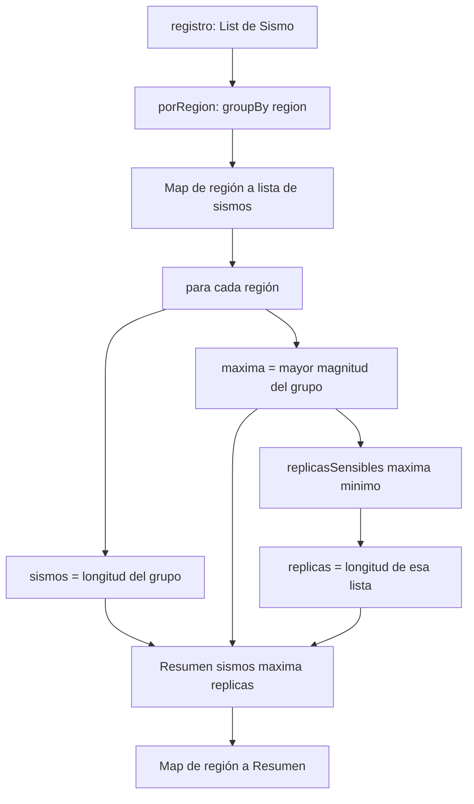

# Informe de proceso: Taller 3, registro sísmico

Fundamentos de Programación Funcional y Concurrente
Escuela de Ingeniería de Sistemas y Computación, Universidad del Valle

En este informe contamos cómo se ejecuta cada función de `RegistroSismico.scala`, paso a paso, y en qué se traduce cada expresión `for` que usamos. Para seguir la ejecución reemplazamos cada expresión por su valor hasta llegar al resultado (modelo de sustitución). En todos los ejemplos usamos el `registro` que trae el enunciado.

## Notación

- $r$ es un registro, es decir, una `List[Sismo]`.
- $s.\text{region}$, $s.\text{magnitud}$ y $s.\text{profundidad}$ son los campos de un `Sismo`.

## Cómo traduce Scala los `for`

Un `for` con `yield` no es un ciclo: el compilador lo convierte en llamadas a `map`, `flatMap` y `withFilter` (la versión perezosa de `filter`). Con un solo generador y una condición:

$$
\text{for } (x \leftarrow xs \text{ if } P(x)) \text{ yield } e(x)
\;\equiv\;
xs.\text{withFilter}(P).\text{map}(x \mapsto e(x))
$$

Con dos generadores y una condición:

$$
\text{for } \{x \leftarrow xs;\ y \leftarrow ys;\ \text{if } g(x,y)\}\ \text{yield } e(x,y)
\;\equiv\;
xs.\text{flatMap}\bigl(x \mapsto ys.\text{withFilter}(y \mapsto g(x,y)).\text{map}(y \mapsto e(x,y))\bigr)
$$

Un `for` sin `yield` se traduce a `foreach`, que es un ciclo. No lo usamos en ningún lado, porque el curso lo prohíbe.

## Punto 1: consultas con expresiones `for`

### `fuertes(r, umbral)`

```scala
def fuertes(r: Registro, umbral: Double): List[String] =
  for (s <- r if s.magnitud > umbral) yield s.region
```

**Se traduce a:** `r.withFilter(_.magnitud > umbral).map(_.region)`.

**Ejecución** con $\text{umbral} = 5.0$:

1. `withFilter` deja pasar los sismos con magnitud mayor que $5.0$: Santander ($5.1$), Choco ($6.0$) y Valle ($5.3$).
2. `map(_.region)` se queda con la región de cada uno.

**Resultado:** $\text{List}(\text{"Santander"}, \text{"Choco"}, \text{"Valle"})$.

`map` respeta el orden de entrada, por eso las regiones salen en el orden en que aparecen en el registro y con repetidos. El umbral es estricto: un sismo de magnitud exactamente igual al umbral no sale.

### `enRegion(r, region)`

```scala
def enRegion(r: Registro, region: String): List[Double] =
  for (s <- r if s.region == region) yield s.magnitud
```

**Se traduce a:** `r.withFilter(_.region == region).map(_.magnitud)`.

**Ejecución** con $\text{region} = \text{"Valle"}$:

1. `withFilter` deja los tres sismos de Valle.
2. `map(_.magnitud)` extrae sus magnitudes.

**Resultado:** $\text{List}(4.2, 3.8, 5.3)$. Si la región no existe, no pasa ningún sismo y el resultado es $\text{List}()$.

### `paresCercanos(r, dif)`

```scala
def paresCercanos(r: Registro, dif: Double): List[(String, String)] = {
  val regiones = (for (s <- r) yield s.region).distinct

  def cercanas(a: String, b: String): Boolean = {
    val magsA = enRegion(r, a)
    val magsB = enRegion(r, b)
    val parejas = for {
      ma <- magsA
      mb <- magsB
      if math.abs(ma - mb) <= dif
    } yield (ma, mb)
    parejas.nonEmpty
  }

  for {
    (a, i) <- regiones.zipWithIndex
    b <- regiones.drop(i + 1)
    if cercanas(a, b)
  } yield (a, b)
}

Esta función tiene tres `for` y una función auxiliar. Se traducen así:

- **`regiones`:** `r.map(_.region).distinct`. Son las regiones en orden de aparición, sin repetir.
- **`parejas`, dentro de `cercanas`:**
  $$
  \text{magsA}.\text{flatMap}\bigl(ma \mapsto \text{magsB}.\text{withFilter}(mb \mapsto |ma - mb| \leq \text{dif}).\text{map}(mb \mapsto (ma, mb))\bigr)
  $$
  Cada $(ma, mb)$ que se genera es una pareja de sismos que cumple la cercanía, y `nonEmpty` solo pregunta si existe al menos una.
- **`for` externo:**
  $$
  \text{regiones}.\text{zipWithIndex}.\text{flatMap}\bigl\{(a,i) \mapsto \text{regiones}.\text{drop}(i+1).\text{withFilter}(b \mapsto \text{cercanas}(a,b)).\text{map}(b \mapsto (a,b))\bigr\}
  $$

**Ejecución** con $\text{dif} = 1.0$:

1. $\text{regiones} = \text{List}(\text{"Valle"}, \text{"Santander"}, \text{"Choco"})$.
2. Para $(a, i) = (\text{"Valle"}, 0)$, $b$ recorre Santander y Choco:
  - Valle y Santander: $|5.3 - 5.1| = 0.2 \leq 1.0$, así que se emite la pareja.
  - Valle y Choco: $|5.3 - 6.0| = 0.7 \leq 1.0$, así que se emite la pareja.
3. Para $(a, i) = (\text{"Santander"}, 1)$, $b$ solo recorre Choco:
  - Santander y Choco: $|5.1 - 6.0| = 0.9 \leq 1.0$, así que se emite la pareja.
4. Para $(a, i) = (\text{"Choco"}, 2)$, $b$ recorre una lista vacía y no se emite nada.

**Resultado:** $\text{List}((\text{"Valle"}, \text{"Santander"}), (\text{"Valle"}, \text{"Choco"}), (\text{"Santander"}, \text{"Choco"}))$.

**Por qué no hay parejas repetidas ni una región consigo misma:** $b$ solo recorre las regiones que vienen *después* de $a$ (eso es `drop(i + 1)`). Así $(\text{"Choco"}, \text{"Valle"})$ nunca se genera, y tampoco $(a, a)$. Cada pareja no ordenada aparece una sola vez, en orden de aparición.

## Punto 2: agrupar con mapas

### `porRegion(r)`

```scala
def porRegion(r: Registro): Map[String, List[Sismo]] =
  r.groupBy(_.region)
```

`groupBy(_.region)` recorre $r$ y mete cada sismo en el grupo de su región, conservando el orden dentro de cada grupo. Con el `registro` queda:

```scala
Map(
  "Valle"     -> List(<sismo 4.2>, <sismo 3.8>, <sismo 5.3>),
  "Santander" -> List(<sismo 5.1>, <sismo 4.7>),
  "Choco"     -> List(<sismo 6.0>, <sismo 3.1>))
```

### `conteoPorRegion(r)`

```scala
def conteoPorRegion(r: Registro): Map[String, Int] =
  porRegion(r).view.mapValues(_.length).toMap
```

**Ejecución:**

1. `porRegion(r)` agrupa los sismos como acabamos de ver.
2. `.view.mapValues(_.length)` cambia cada lista por su longitud, sin construir un mapa intermedio.
3. `.toMap` fuerza el cálculo y devuelve un `Map` normal.

**Resultado:** $\text{Map}(\text{"Valle"} \mapsto 3, \text{"Santander"} \mapsto 2, \text{"Choco"} \mapsto 2)$.

### `magnitudMaxima(r)`

```scala
def magnitudMaxima(r: Registro): Map[String, Double] =
  porRegion(r).view.mapValues(_.map(_.magnitud).max).toMap
```

**Ejecución:**

1. `porRegion(r)` agrupa por región.
2. En cada grupo, `_.map(_.magnitud)` saca las magnitudes y `.max` se queda con la mayor.
3. `.toMap` fuerza el cálculo.

**Resultado:** $\text{Map}(\text{"Valle"} \mapsto 5.3, \text{"Santander"} \mapsto 5.1, \text{"Choco"} \mapsto 6.0)$.

Las regiones que no están en el registro no aparecen, porque `groupBy` solo crea grupos para las llaves que encuentra. Con el registro vacío el resultado es $\text{Map}()$.

## Punto 3: consultas seguras

### `conteoSeguro(r)`

```scala
def conteoSeguro(r: Registro): Map[String, Int] =
  conteoPorRegion(r).withDefaultValue(0)
```

**Ejecución:**

1. Se calcula `conteoPorRegion(r)`.
2. `.withDefaultValue(0)` devuelve el mismo mapa, pero con un valor por defecto: si piden una llave que no existe, responde $0$ en lugar de lanzar `NoSuchElementException`.

**Resultado:** $\text{conteoSeguro}(\text{registro})(\text{"Valle"}) = 3$ y $\text{conteoSeguro}(\text{registro})(\text{"Amazonas"}) = 0$. Los conteos de las regiones que sí están no cambian.

### `maximaDe(r, region)`

```scala
def maximaDe(r: Registro, region: String): Option[Double] =
  enRegion(r, region).maxOption
```

**Ejecución** con $\text{region} = \text{"Choco"}$:

1. `enRegion(r, "Choco")` da $\text{List}(6.0, 3.1)$.
2. `maxOption` devuelve `Some` del máximo si la lista tiene elementos, y `None` si está vacía.

**Resultado:** $\text{Some}(6.0)$. Con $\text{region} = \text{"Amazonas"}$ la lista es vacía y el resultado es $\text{None}$.

### `regionMasActiva(r)`

```scala
def regionMasActiva(r: Registro): Option[String] =
  if (r.isEmpty) None
  else {
    val conteos = conteoPorRegion(r)
    val mayor = conteos.values.max
    Some(conteos.filter(_._2 == mayor).keys.min)
  }
```

**Ejecución** con el `registro`:

1. $r$ no está vacío, así que se pasa al `else`.
2. $\text{conteos} = \text{Map}(\text{"Valle"} \mapsto 3, \text{"Santander"} \mapsto 2, \text{"Choco"} \mapsto 2)$.
3. $\text{mayor} = 3$.
4. `filter(_._2 == 3)` deja solo Valle.
5. `keys.min` es $\text{"Valle"}$, y la función devuelve $\text{Some}(\text{"Valle"})$.

Con el registro vacío devuelve $\text{None}$. Si hay empate, `filter` deja varias regiones y `keys.min` elige la primera en orden alfabético (por ejemplo, Arauca antes que Zulia).

## Punto 4: réplicas perezosas

### `redondear(x)`

```scala
def redondear(x: Double): Double = Math.round(x * 100.0) / 100.0
```

Multiplica por $100$, redondea al entero más cercano y divide por $100.0$. Con $x = 2.048$: $2.048 \cdot 100 = 204.8$, `round` da $205$ y $205 / 100.0 = 2.05$. Con $x = 3.2$: $320.0$, $320$ y $3.2$ (queda igual).

### `replicas(magnitud)`

```scala
def replicas(magnitud: Double): LazyList[Double] =
  LazyList.iterate(redondear(magnitud))(x => redondear(x * 0.8))
```

`LazyList.iterate(inicial)(f)` produce $\text{inicial}, f(\text{inicial}), f(f(\text{inicial})), \dots$, pero **solo calcula un elemento cuando alguien lo pide**.

**Ejecución** con $\text{magnitud} = 5.0$:

1. El primer elemento es $\text{redondear}(5.0) = 5.0$.
2. Con $f(x) = \text{redondear}(0.8x)$ salen: $f(5.0) = 4.0$, $f(4.0) = 3.2$, $f(3.2) = 2.56$, $f(2.56) = 2.05$, y así sin parar.

La secuencia es $5.0, 4.0, 3.2, 2.56, 2.05, 1.64, \dots$

Por eso `replicas(5.0).take(4).toList` devuelve $\text{List}(5.0, 4.0, 3.2, 2.56)$ sin colgarse: solo se calculan cuatro elementos. Si `replicas` devolviera una `List`, el programa intentaría construir la lista infinita completa y nunca terminaría.

### `replicasSensibles(magnitud, minimo)`

```scala
def replicasSensibles(magnitud: Double, minimo: Double): List[Double] =
  replicas(magnitud).takeWhile(_ > minimo).toList
```

**Ejecución** con $\text{magnitud} = 5.0$ y $\text{minimo} = 3.0$:

1. `replicas(5.0)` es la secuencia perezosa $5.0, 4.0, 3.2, 2.56, \dots$
2. `takeWhile(_ > 3.0)` va pidiendo elementos mientras cumplan la condición:
  - $5.0 > 3.0$, entra.
  - $4.0 > 3.0$, entra.
  - $3.2 > 3.0$, entra.
  - $2.56 > 3.0$ es falso, así que se detiene.
3. `toList` pasa a una lista solo los tres elementos que entraron.

**Resultado:** $\text{List}(5.0, 4.0, 3.2)$. El mínimo es estricto: con $\text{magnitud} = 3.0$ y $\text{minimo} = 3.0$ el primer elemento ya falla y el resultado es $\text{List}()$.

### Por qué la secuencia infinita no agota la memoria

Una `LazyList` solo guarda en memoria los elementos que ya se calcularon. El resto de la secuencia infinita no existe todavía: es una promesa de "cuando me pidan el siguiente, lo calculo con $f$".

En `replicasSensibles`, `takeWhile` calcula elementos hasta encontrar el primero que no cumple. Con mínimo $3.0$ son cuatro ($5.0, 4.0, 3.2$ y $2.56$). Luego `toList` copia a una lista solo el prefijo que sí cumple. Entonces **la memoria que se gasta depende de cuántas réplicas se piden, no de que la secuencia sea infinita**.

**Cuándo sí terminaría mal.** Con el redondeo a dos decimales la secuencia deja de bajar en $0.02$, porque $0.02 \cdot 0.8 = 0.016$ y eso vuelve a redondear a $0.02$. Por eso `replicasSensibles` termina siempre que $\text{minimo} \geq 0.02$. Con un mínimo menor (por ejemplo $0.0$) la condición `_ > minimo` se cumple para siempre, `takeWhile` nunca se detiene y el programa se queda calculando hasta agotar la memoria. Si se quiere probar ese caso, hay que acotar sobre la secuencia perezosa, antes de pasar a `List`, con `replicas(5.0).takeWhile(_ > 0.0).take(5).toList`.

## Punto 5: informe combinado

```scala
def informe(r: Registro, minimo: Double): Map[String, Resumen] =
  porRegion(r).view.mapValues { sismos =>
    val maxima = sismos.map(_.magnitud).max
    Resumen(sismos.length, maxima, replicasSensibles(maxima, minimo).length)
  }.toMap
```

**Ejecución** con el `registro` y $\text{minimo} = 3.0$:

1. `porRegion(r)` agrupa los sismos por región.
2. Para cada grupo se calcula la magnitud máxima, el número de sismos y cuántas réplicas sensibles tiene el sismo más fuerte.
3. Con eso se arma un `Resumen` por región y `toMap` fuerza el cálculo.

| Región | Magnitudes | Máxima | `replicasSensibles(máxima, 3.0)` | Resumen |
|---|---|---|---|---|
| Valle | $4.2, 3.8, 5.3$ | $5.3$ | $5.3, 4.24, 3.39$ (3) | $\text{Resumen}(3, 5.3, 3)$ |
| Santander | $5.1, 4.7$ | $5.1$ | $5.1, 4.08, 3.26$ (3) | $\text{Resumen}(2, 5.1, 3)$ |
| Choco | $6.0, 3.1$ | $6.0$ | $6.0, 4.8, 3.84, 3.07$ (4) | $\text{Resumen}(2, 6.0, 4)$ |

En Valle, por ejemplo, la secuencia sigue $5.3, 4.24, 3.39, 2.71$, pero $2.71$ ya no supera $3.0$ y `takeWhile` se detiene ahí.

**Resultado:**

```scala
Map(
  "Valle"     -> Resumen(3, 5.3, 3),
  "Santander" -> Resumen(2, 5.1, 3),
  "Choco"     -> Resumen(2, 6.0, 4))
```

Con el registro vacío, `groupBy` no crea ningún grupo y el resultado es $\text{Map}()$. Si el mínimo es mayor que la magnitud máxima de una región, ese sismo ya no supera el mínimo y su cantidad de réplicas es $0$.

## Diagrama del procesamiento



## Resumen de traducciones de los `for`

| Función | `for` usado | Se traduce a |
|---|---|---|
| `fuertes` | `for (s <- r if s.magnitud > umbral) yield s.region` | `r.withFilter(_.magnitud > umbral).map(_.region)` |
| `enRegion` | `for (s <- r if s.region == region) yield s.magnitud` | `r.withFilter(_.region == region).map(_.magnitud)` |
| `paresCercanos` (lista de regiones) | `for (s <- r) yield s.region` | `r.map(_.region)` |
| `paresCercanos` (dentro de `cercanas`) | `for { ma <- magsA; mb <- magsB; if ... } yield (ma, mb)` | `magsA.flatMap(ma => magsB.withFilter(...).map(mb => (ma, mb)))` |
| `paresCercanos` (el de afuera) | `for { (a,i) <- regiones.zipWithIndex; b <- regiones.drop(i+1); if cercanas(a,b) } yield (a,b)` | `regiones.zipWithIndex.flatMap { case (a,i) => regiones.drop(i+1).withFilter(b => cercanas(a,b)).map(b => (a,b)) }` |

Todos los `for` del taller llevan `yield` y producen una colección nueva. Ninguno es un `for` sin `yield`, que se traduciría a `foreach` y sería un ciclo iterativo.

Todos los for del taller tienen yield y producen una colección nueva. Ninguno es un for sin yield (que se traduciría a foreach y sería un ciclo iterativo, prohibido en el curso).